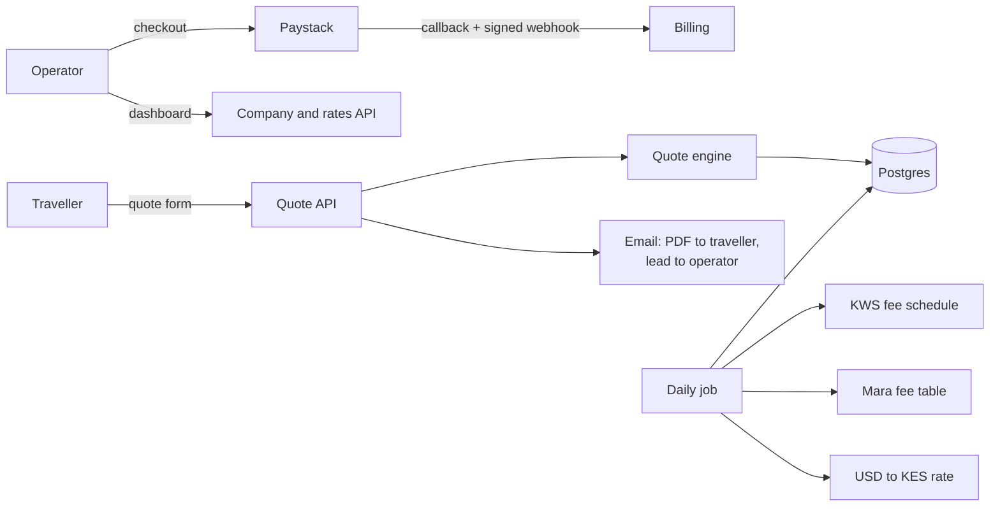

# SafariQuote AI

**Instant, accurate safari quotes for Kenyan tour operators.**

> The source code for this product is private because it is a commercial SaaS. This page describes what it does and how it is built. A live demo and code walkthrough are available on request.

SafariQuote gives every safari company its own quote page. A traveller enters their dates, group size, destinations and preferences. Within seconds they see a day-by-day itinerary with a full price breakdown, and the same quote arrives in their inbox as a branded PDF. The operator gets the lead by email, and optionally as a row in their Google Sheet. Operators pay a monthly subscription in Kenyan shillings through Paystack, by M-Pesa or card.

## The problem

Most small safari operators in Kenya quote by hand. A WhatsApp enquiry means looking up vehicle and lodge rates, working out park fees for the traveller's residency and season, adding meals, and typing it all into a document. That often takes hours while the traveller is asking other operators.

Park fees are where mistakes happen:
- Kenya Wildlife Service and the Maasai Mara reserve publish different rates for citizens, residents and international visitors.
- The Mara price doubles from July to December.
- A part day in a park is charged as a full day.

## What it does

- **Quote form per operator:** each operator gets a branded public quote page to share on their website, Instagram or WhatsApp.
- **Instant pricing:**
  - transport and lodges come from the operator's own rates;
  - park entry fees come from the official KWS and Maasai Mara schedules, refreshed daily and priced by residency and season, one ticket per night at each park;
  - meals use the operator's own rate.
- **PDF quote by email** to the traveller, with the lead sent to the operator and synced to Google Sheets.
- **Optional AI itinerary writing** that may word the day-by-day plan but never sets prices.
- **Subscriptions in KES** through Paystack (M-Pesa or card):
  - 30-day paid periods; renewals carry no setup fee;
  - every payment is applied exactly once;
  - automatic expiry reminders.
- **Protection:** rate-limited public endpoints, validated input, and database access only from the server.

## Plans

| Plan | Setup | Monthly | Includes |
| --- | --- | --- | --- |
| Starter | KSh 3,000 | KSh 1,500 | Quote form, rate management |
| Professional | KSh 3,000 | KSh 2,500 | + logo, contact details, Google Sheets sync |
| Enterprise | none | KSh 5,000 | + custom colors, white-label form |

## Architecture

## Built with

Next.js 16 (App Router) · TypeScript · Tailwind · Clerk · Supabase (Postgres + storage) · Paystack · Resend · pdf-lib · Google Sheets API · Vitest

## Engineering highlights

- **Park fees from official sources:**
  - parses the KWS conservation-fee PDF and the Mara fee table every day;
  - sanity-checks the numbers before replacing stored fees, and falls back to the last good copy;
  - handles a government site that serves an incomplete TLS certificate chain, without disabling verification.
- **Billing that is hard to break:**
  - Paystack confirms each payment twice (callback plus webhook), and a ledger table with a unique key applies it once;
  - renewing early stacks days instead of losing them;
  - access is checked on every request, so a missed cron run never gives free use.
- **52 automated tests** covering pricing, park fees, billing and Paystack signature checks, tested against real copies of the official fee documents.

## Screenshots

_Coming soon: quote form on a phone, a priced quote, the emailed PDF, and the operator dashboard._

## Contact

Built by Jesse Ngugi, Nairobi. [GitHub](https://github.com/ngugiauraa) · [Portfolio](https://ngugi.pages.dev)
